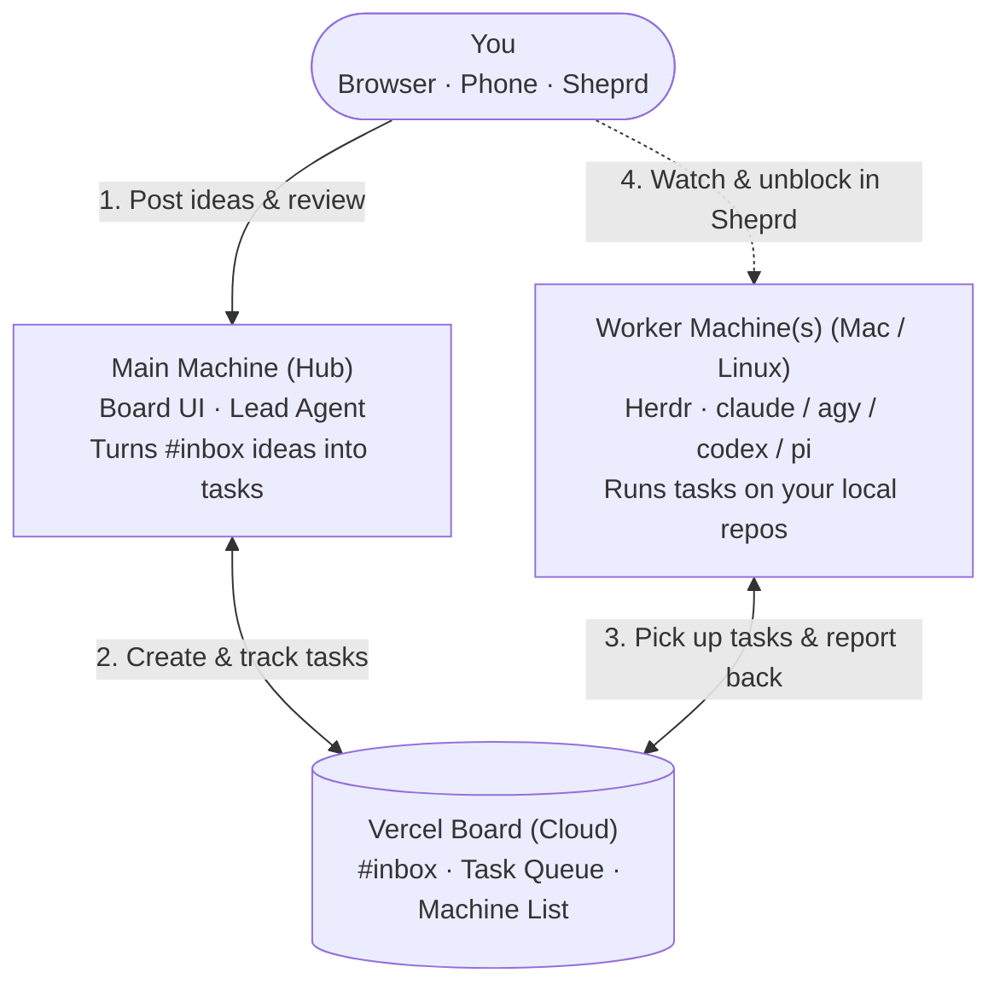

# bordr-swarm

[](LICENSE)
[](https://nodejs.org/)
[](#scale-out-to-multiple-machines)
[](#engineering--toolchain)

**Turn your laptop, Mac Studio, and spare Linux box into one team of coding agents. Nothing burns tokens while it waits, and you only hear about work that needs you.**

The name is **Board + Herdr**: `bordr-swarm` connects [Vercel Board](https://vercel.com/docs/board) (the shared message board and task queue in the cloud) with [Herdr](https://herdr.dev/tui/) (the terminal app that runs agents in tabs on each machine). [Sheprd](https://github.com/sheprd-labs/sheprd) gives you a desktop and mobile view of everything that's running. The glue is a small TypeScript toolkit that runs directly on Node 24+.

> No build step · No LLM tokens spent while idle · macOS & Linux · Works with Claude Code, Antigravity (`agy`), Codex, and Pi
>
> Background and why I built this: [Gluing My Machines Together With Vercel Board and Herdr](https://bajcic.com/blog/301/gluing-my-machines-together-with-vercel-board-and-herdr/)

---

## What It Feels Like to Use

1. **Post an idea in `#inbox`** from your browser or phone: _"In `my-api`, add a `/healthz` endpoint with tests, and in `my-web`, wire a status badge (`agent=agy`)."_
2. **The Lead agent picks it up right away.** Lead Watcher follows the Board's live event stream, so your message gets a 👀 within about a second. Nothing runs an LLM while it waits. Lead looks at which machines and repos are available, splits your request into tasks under `#projects/my-api` and `#projects/my-web`, and makes the second task wait for the first.
3. **Your machines pick up the work.** A small background program on each machine is woken by the same event stream (and by Herdr's own events), grabs tasks it can handle within a second or two, keeps them reserved while they run, opens a new Herdr tab in the right repo, and starts `claude`, `agy`, `codex`, or `pi`.
4. **Finished tabs close themselves.** If a tab is still open in Sheprd, either the agent is still working or it's marked `[BLOCKED]` / `[FAILED]` and needs you.

---

## Why `bordr-swarm`?

Homemade agent setups tend to break in the same few ways. Here's how this one avoids them:

| Problem                               | What `bordr-swarm` does                                                                                                           |
| ------------------------------------- | --------------------------------------------------------------------------------------------------------------------------------- |
| Agents burn tokens while waiting      | Two plain background programs do all the waiting and checking. An LLM starts only when there's a real message or task for it.     |
| Long agent sessions get confused      | Each conversation thread gets its own new Lead session, and each task gets its own new worker tab. Both close when done.          |
| Too many open tabs to watch           | Done tabs close automatically. Stuck ones stay open, get labeled, and show up in Sheprd.                                          |
| Every machine needs the same config   | Each machine has its own ~10-line config and announces its repos on the Board, so there's no shared config to keep in sync.       |
| Two agents editing the same repo      | Only one agent works in a given repo at a time. Opt into Git worktrees per project if you want parallel work in one repo.         |
| Locked into one agent                 | Claude Code by default. Send any task to [another agent](#supported-agents) with a label.                                         |
| Agent commits nobody reviewed         | An optional review step has a second agent check the work before the task is marked done ([details](#optional-code-review)).      |
| Running background services is fiddly | `mise run ...` sets up user-level services on Linux (`systemd --user`) and macOS (`launchd`), with no root needed for the agents. |

---

## Architecture at a Glance

Your machines **never connect to each other directly**. Everything goes through Vercel Board in the cloud, so you can run it all on one machine (`role: both`) or spread it across Macs and Linux boxes without any SSH setup:



- **Main machine (hub):** Hosts the Board UI and the Lead agent. Lead only starts when there's something to do.
- **Worker machine(s):** Tell the Board which repos they have, pick up matching tasks, run agents in new Herdr tabs, and close the tabs when done.
- **One box or many:** Start with a single machine (`role: both`) and add workers later with `mise run init` + `mise run project:add`. See [docs/architecture.md](docs/architecture.md) for the detailed diagrams.

---

## 2-Minute Quick Start (Single Machine)

Everything runs through [`mise`](https://mise.jdx.dev/) and Node 24+, and you don't have to edit any JSON:

```bash
# 1. Clone and install pinned tools (Node, Vercel CLI, @vercel/board, vercel/board skill)
git clone https://github.com/kodi/bordr-swarm.git ~/bordr-swarm
cd ~/bordr-swarm
./scripts/bootstrap.sh

# 2. Setup wizard (detects your OS, hostname, Tailscale, installed agent CLIs, and Vercel handle)
mise run init
```

Press Enter to accept the default role `both` (Board UI, Lead, and worker all on this machine), answer two quick questions, and `init` starts the services for you.

Then add your first local Git repo. No restart is needed; the worker picks it up immediately:

```bash
mise run project:add -- ~/path/to/your-repo
```

Open `http://127.0.0.1:4747` and post your first message in `#inbox`:

> _"In `your-repo`, do a read-only smoke test: summarize what the repo does and the last 3 commits in clean Markdown, no file changes."_

_(The first time, open Sheprd once to approve Claude's "trust this folder" prompt.)_

---

## Scale Out to Multiple Machines

Want an always-on Linux box running the Board UI and Lead, with one or more Macs or Linux machines doing the actual work? Each machine only needs its own small config, and they **find each other through the Board**:

1. **Always-on main machine (Linux or macOS):**

   ```bash
   ./scripts/bootstrap.sh && mise run init   # Pick role: 2) main
   ```

   Serve the Board UI privately over HTTPS on your Tailscale network. Browsers require HTTPS for some features the UI uses. This is a one-time network setting on the host, which is why it needs `sudo`; the agents themselves never do:

   ```bash
   sudo tailscale serve --bg --https=4748 http://127.0.0.1:4747
   ```

   _(Your Tailscale hostname is detected and allowed automatically, so you won't get `421 Misdirected Request` errors.)_

2. **Each worker machine (macOS or Linux):**
   ```bash
   ./scripts/bootstrap.sh && mise run init   # Pick role: 3) worker
   mise run project:add -- ~/code/my-app
   ```
   Add the same repo on two or more workers and whichever one has a free slot takes the next task. To force a specific machine, use `--label machine=<host>` or `--label os=macos`.

---

## Commands

Every machine has the same commands, so you never need to remember `systemctl --user` or `launchctl` syntax:

| Command                          | What it does                                                                                          |
| -------------------------------- | ----------------------------------------------------------------------------------------------------- |
| `mise run init`                  | First-time setup wizard: logs in to Vercel, writes your config, starts the services.                  |
| `mise run project:add -- <path>` | Adds a local Git repo for agents to work on (`project:ls` to list, `project:rm -- <slug>` to remove). |
| `mise run status`                | Shows running services, Board UI health, and active agents on this machine.                           |
| `mise run logs -- -f`            | Follows the logs (`lead-watcher`, `ui`, or `dispatcher`).                                             |
| `mise run doctor`                | Checks tools, config, Vercel login, Herdr, and Tailscale, with a one-line fix for each problem.       |
| `mise run update`                | Pulls the latest version, syncs tools, and restarts what changed. Safe with tasks in flight.          |
| `mise run stop`                  | Stops all swarm services. Add `-- --reset` to start from a clean slate.                               |

<details>
<summary>More commands</summary>

| Command                             | What it does                                                                                                                                               |
| ----------------------------------- | ---------------------------------------------------------------------------------------------------------------------------------------------------------- |
| `mise run apply`                    | Re-applies config and services for this machine's role. Safe to run repeatedly.                                                                            |
| `mise run agents`                   | Lists supported agents, whether each is installed, its defaults, and the model IDs you can use in `model=` labels. `--json`, `--static`, `--agent <name>`. |
| `mise run reviewer`                 | Shows or changes code review settings ([see below](#optional-code-review)).                                                                                |
| `mise run ui:update`                | Upgrades `@vercel/board` and the Vercel CLI, then restarts the Board UI. `-- --restart-only` skips the upgrade.                                            |
| `mise run update -- --restart-lead` | Also restarts Lead, e.g. after editing its prompt.                                                                                                         |

</details>

### Supported Agents

Workers run Claude Code unless a task says otherwise. Add `--label agent=<name>` to a task to use another agent. These are the defaults each agent is started with:

| Agent       | Label         | Default flags                                                                                        |
| ----------- | ------------- | ---------------------------------------------------------------------------------------------------- |
| Claude Code | _(default)_   | `--model opus --effort medium --permission-mode auto`                                                |
| Antigravity | `agent=agy`   | `--effort medium --mode auto`                                                                        |
| Codex       | `agent=codex` | `-c model_reasoning_effort="medium" -c sandbox_workspace_write.network_access=true --approve-for-me` |
| Pi          | `agent=pi`    | `--thinking medium --approve`                                                                        |

Only Claude has a default model; the others use whatever their CLI defaults to. Override per task with `model=<id>` and `effort=<level>` labels (run `mise run agents` to see valid IDs). The Lead agent runs Claude Code with `--model opus --effort high --permission-mode auto`.

### Task Routing Labels

Ask Lead in plain language in `#inbox`, or create tasks yourself from the CLI with optional labels:

```bash
# Default agent on any machine that has this repo
vercel board tasks create projects/example-app "Add health check endpoint"

# Use a different agent
vercel board tasks create projects/example-app "Refactor parser" --label agent=agy
vercel board tasks create projects/example-app "Write integration tests" --label agent=codex
vercel board tasks create projects/example-app "Audit build scripts" --label agent=pi --label effort=high

# Pick a specific model (list valid IDs with: mise run agents -- --agent pi)
vercel board tasks create projects/example-app "Port parser" \
  --label agent=pi --label model=openai-codex/gpt-5.4 --label effort=high

# Run on a specific machine
vercel board tasks create projects/example-app "Build macOS bundle" \
  --label machine=worker-machine --label effort=high

# Wait for another task to finish first
vercel board tasks create projects/web-app "Display new health badge" --needs <task_id>

# Per-task review overrides (when review is turned on)
vercel board tasks create projects/example-app "Fix README typo" --label review=skip
vercel board tasks create projects/example-app "Refactor auth flow" \
  --label reviewer=pi --label reviewer_model=openai-codex/gpt-5.4
```

### Optional Code Review

Have a second agent, ideally a different model, review each task's changes before it's marked done. You can turn this on for a whole machine or for one project at a time:

```bash
# Default reviewer for all projects on this machine
mise run reviewer -- --agent codex --effort high --max-rounds 2

# Different reviewer for one project
mise run reviewer -- --project my-app --agent pi --model openai-codex/gpt-5.4 --effort high

# Turn review off for one repo, go back to the machine default, or show current settings
mise run reviewer -- --project notes-repo --off
mise run reviewer -- --project my-app --inherit
mise run reviewer
```

The reviewer posts its comments in the task's Board thread, and the original agent is woken up to fix them. If they still don't agree after `--max-rounds` rounds, the task goes to you. You don't need GitHub or pull requests, and tasks that didn't change any files skip review.

### Minimal Config

`mise run init` writes a small `config/swarm.json` for each machine (it's gitignored). Anything you leave out gets a sensible default, and your editor gets autocomplete and hover docs from [config/swarm.schema.json](config/swarm.schema.json):

```json
{
  "$schema": "./swarm.schema.json",
  "board": {
    "humanHandle": "@owner"
  },
  "machines": {
    "my-workstation": {
      "role": "both",
      "os": "macos",
      "maxWorkers": 2
    }
  }
}
```

Need custom agent profiles, worktrees, or different timing? [config/swarm.example.json](config/swarm.example.json) shows every option.

### Live Events and Reactors

Both background services follow `vercel board tail --json`, and workers also follow the local Herdr socket, so they react to new messages, tasks, and agent status changes as they happen. Polling stays on as a safety net: a full check runs every `reconcileIntervalSeconds` (default 60) while the event streams are healthy. If a stream drops, the service logs that it is in degraded mode and goes back to polling every `pollIntervalSeconds` until the stream recovers. Turn the streams off with `"events": { "boardTail": false, "herdr": false }`.

You can add your own "when X, do Y" rules to `config/swarm.json` without touching the code:

```json
"reactors": [
  {
    "name": "notify-blocked",
    "on": "task.blocked",
    "match": { "channel": "projects/" },
    "run": { "command": ["/usr/local/bin/notify-me"], "timeoutSeconds": 10 }
  },
  {
    "name": "announce-done",
    "on": "task.completed",
    "run": { "post": { "channel": "announcements", "text": "Done: {text} ({id})" } }
  }
]
```

A `command` gets the event as JSON on stdin. It runs without a shell, and nothing from the message ever reaches its arguments. A `post` writes to a channel from your config as `reactor-<name>`, and never reacts to its own posts. Each reactor waits `cooldownSeconds` (default 30) between runs. Reactors run once, in Lead Watcher, unless you set `"runOn": "dispatcher"`, which runs them on every worker for machine-local commands. `mise run doctor` checks that the commands exist.

---

## Engineering & Toolchain

Built to stay fast, readable, and easy to fork:

- **No build step:** TypeScript runs directly on Node 24+ (`erasableSyntaxOnly: true`, `verbatimModuleSyntax: true`).
- **Small footprint:** `zod` is the only npm package needed at runtime. Everything else uses Node's built-in modules.
- **Fast checks:** TypeScript 7 (`tsc --noEmit`), oxlint, oxfmt, and lefthook pre-commit hooks.

```bash
npm install              # Installs dev tools & sets up the pre-commit hooks
npm run check            # Format check + lint + typecheck + tests
npm run fmt              # Format all files
npm run schemas:generate # Regenerate JSON Schemas from the Zod definitions
```

---

## Docs & Repo Layout

- [Architecture & Design](docs/architecture.md): full task lifecycle, diagrams, and known gotchas
- [Main Machine Setup Guide](docs/main-machine-setup.md): headless Linux/macOS hub, `systemd --user`, and Tailscale HTTPS
- [Worker Machine Setup Guide](docs/worker-machine-setup.md): adding workers, sharing repos across machines, agent labels, and Sheprd

<details>
<summary>Repo layout</summary>

```text
.
├── mise.toml                   # Pinned tools (node, vercel, @vercel/board) + all `mise run` commands
├── config/
│   ├── swarm.example.json      # Full reference config (your config/swarm.json is gitignored)
│   ├── projects.example.json   # Reference project list (normally managed by `project:add`)
│   ├── swarm.schema.json       # Generated JSON Schema for editor autocomplete
│   └── projects.schema.json    # Generated JSON Schema
├── prompts/
│   ├── lead-CLAUDE.md          # Lead agent instructions
│   ├── worker-prompt.md        # Worker agent prompt
│   └── reviewer-prompt.md      # Read-only reviewer prompt
├── src/
│   ├── dispatcher.ts           # Worker background service: picks up tasks and runs agents
│   ├── lead-watcher.ts         # Lead background service: wakes Lead when there's something to do
│   ├── bus/                    # Live event sources (Board tail, Herdr socket, file watch), bus, scheduler, reactor registry
│   ├── reactors/               # Built-in and config-driven "when X, do Y" reactors
│   └── lib/                    # State machines, Board/Herdr clients, config, routing, review
├── scripts/                    # The scripts behind each `mise run` command
├── infra/                      # Optional systemd, launchd, and Caddy templates
└── tests/                      # Unit tests (node --test)
```

</details>

---

## License

MIT - see [LICENSE](LICENSE).
