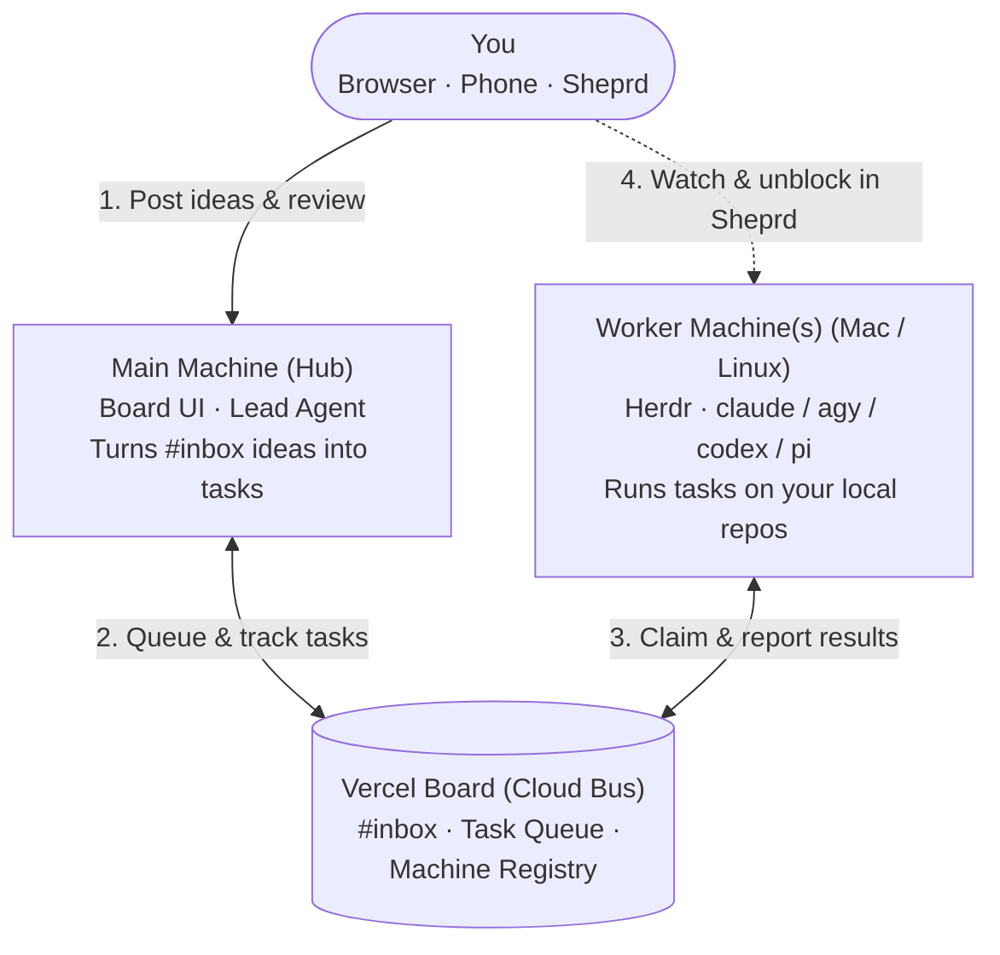

# bordr-swarm

**Turn your laptop, Mac Studio, and spare Linux box into a self-organizing coding-agent fleet - with zero idle token burn and an exception-only dashboard.**

`bordr-swarm` wires together **[Vercel Board](https://vercel.com/docs/board)** (hosted team control plane & atomic task queue), **[Herdr](https://herdr.dev/tui/)** (terminal, workspace & agent runtime), and **[Sheprd](https://github.com/sheprd-labs/sheprd)** (desktop + mobile UI) using a lightweight, declarative TypeScript/Node 24+ toolkit.

> **1 runtime dependency (`zod`)** · **Zero build step** (native Node TS) · **0 idle LLM tokens** · **macOS & Linux** · **Claude Code + Antigravity (`agy`) + Codex + Pi**
>
> Background & why I built this: **[Gluing My Machines Together With Vercel Board and Herdr](https://bajcic.com/blog/301/gluing-my-machines-together-with-vercel-board-and-herdr/)**

---

## What It Feels Like to Use

1. **Drop an idea in `#inbox`** from your browser or phone - _"In `my-api`, add a `/healthz` endpoint with tests, and in `my-web`, wire a status badge (`agent=agy`)."_
2. **Lead wakes up instantly** (0 tokens while idle), reads the live fleet catalog, splits your request into self-contained tasks under `#projects/my-api` and `#projects/my-web`, and wires dependencies with `--needs`.
3. **Workers across your machines claim & execute** - each host's deterministic Dispatcher atomically claims matching tasks, renews leases every 5 minutes, opens a fresh Herdr tab in the right checkout, and runs `claude`, `agy`, `codex`, or `pi`.
4. **Finished tabs vanish; blockers surface** - when a task completes, its tab closes automatically. **Any worker tab still open in Sheprd means either actively working or `[BLOCKED]` / `[FAILED]` waiting on human eyes.**

---

## Why `bordr-swarm`?

Most DIY agent swarms fail in the same four ways: polling loops burn tokens overnight, LLMs forget to renew task leases, stale long-lived sessions corrupt repo state, and adding a second machine turns into a YAML/SSH nightmare. `bordr-swarm` solves each one deterministically:

| Pain Point                            | How `bordr-swarm` Solves It                                                                                                                                                                                                                                                                                                              |
| ------------------------------------- | ---------------------------------------------------------------------------------------------------------------------------------------------------------------------------------------------------------------------------------------------------------------------------------------------------------------------------------------- |
| **Idle LLM token burn & context rot** | Two tiny TypeScript daemons - **Lead Watcher** and **Worker Dispatcher** - handle all polling, deduplication, task claiming, and `15m` lease renewals (every `5m`). Lead only wakes when a real `#inbox` post, `@lead` mention, or `blocked` task arrives, running in a fresh ephemeral per-thread tab that auto-closes once idle.       |
| **Tab soup & babysitting**            | Completed worker tabs auto-close. Blocked or failed tabs stay open, renamed `[BLOCKED]` / `[FAILED]`, and light up in **Sheprd** (desktop & mobile). Closing a parked tab frees its slot and repo lock.                                                                                                                                  |
| **Cross-machine config drift**        | **Zero fleet-wide config.** Each machine runs a ~10-line local `config/swarm.json`. Workers auto-publish their capabilities and repo slugs to `#swarm/registry` (keeping local filesystem paths private), and Lead auto-syncs the merged catalog.                                                                                        |
| **Repo collisions**                   | Workers spawn in plain Herdr tabs guarded by a **per-repo lock** so two agents never mutate the same working tree simultaneously - with opt-in `useWorktree: true` per project when you want parallel work on one repo.                                                                                                                  |
| **Single-agent lock-in**              | Default workers run **Claude Code** (`opus`, medium effort, `--permission-mode auto`), and any task can route to **Antigravity (`agy`)**, **Codex (`codex`)**, or **Pi (`pi`)** via `--label agent=<name>` (plus optional `model=` / `effort=` overrides).                                                                               |
| **Unreviewed agent commits**          | Optional **Board-native Code Review Gate** spawns a separate **Reviewer** agent/model (configured globally per worker or overridden per project) in the same checkout before completion - keeping all review comments in the Board task thread, waking the original implementer for fixes, and escalating cleanly if `maxRounds` is hit. |
| **OS service & proxy headaches**      | One unified CLI (`mise run ...`) wraps `systemd --user` (Linux, unprivileged, `linger`-checked), `launchd` (macOS, race-free `kickstart`/`bootout`), auto-detected Tailscale MagicDNS `--allow-host`, and pull-based `mise run update`.                                                                                                  |

---

## Architecture at a Glance

Main and worker machines **never connect directly to each other** - **Vercel Board** sits in the middle as the shared cloud bus, so you can run everything on one machine (`role: both`) or spread work across Macs and Linux boxes with zero SSH wiring:



- **Main machine (hub):** Hosts the Board UI and **Lead Agent** (woken on demand by a 0-token watcher - no idle LLM burn).
- **Worker machine(s):** Announce their local repos to the registry, claim matching tasks, run `claude`, `agy`, `codex`, or `pi` in fresh **Herdr** tabs, and auto-close tabs on completion.
- **One box or many:** Start on a single machine (`role: both`) and add extra workers anytime with `mise run init` + `mise run project:add`. See [docs/architecture.md](docs/architecture.md) for the detailed daemon, lease-renewal, and task lifecycle diagrams.

---

## 2-Minute Quick Start (Single Machine)

No hand-editing JSON required. Everything runs through [`mise`](https://mise.jdx.dev/) + Node 24+ native TypeScript:

```bash
# 1. Clone and install pinned tools (Node, Vercel CLI, @vercel/board, vercel/board skill)
git clone https://github.com/kodi/bordr-swarm.git ~/bordr-swarm
cd ~/bordr-swarm
./scripts/bootstrap.sh

# 2. Interactive setup wizard (auto-detects OS, hostname, Tailscale, CLIs & Vercel handle)
mise run init
```

Press **Enter** to accept the default role **`both`** (Board UI + Lead + Worker on one machine), answer 2 quick prompts, and let `init` start your services.

Then register your first local Git repo (no restart needed - the Dispatcher hot-reloads and publishes to `#swarm/registry` automatically):

```bash
mise run project:add -- ~/path/to/your-repo
```

Open **`http://127.0.0.1:4747`** and drop your first message in `#inbox`:

> _"In `your-repo`, do a read-only smoke test: summarize what the repo does and the last 3 commits in clean Markdown, no file changes."_

_(On first run, open **Sheprd** once to approve Claude's folder-trust prompt.)_

---

## Scale Out to Multiple Machines

Want an always-on Linux box hosting the Board UI + Lead, and one or more Macs/Linux workstations doing the heavy lifting? Each host only needs its own tiny local config - **machines discover each other automatically via `#swarm/registry`**:

1. **Always-on main host (Linux or macOS):**

   ```bash
   ./scripts/bootstrap.sh && mise run init   # Pick role: 2) main
   ```

   Expose the Board UI privately over HTTPS with automatic Let's Encrypt certs (browsers require a Secure Context for `crypto.randomUUID()`):

   ```bash
   sudo tailscale serve --bg --https=4748 http://127.0.0.1:4747
   ```

   _(Your Tailscale MagicDNS hostname is auto-detected and added to `--allow-host` - no `421 Misdirected Request` surprises.)_

2. **Each worker host (macOS or Linux):**
   ```bash
   ./scripts/bootstrap.sh && mise run init   # Pick role: 3) worker
   mise run project:add -- ~/code/my-app
   ```
   Register the same repo slug on **two or more workers** and Lead automatically sees both hosts (`defaultMachine: "any"`), letting whichever machine has free slots claim the task - or pin it explicitly with `--label machine=<host>` / `--label os=macos`.

---

## Developer Experience (DX) Toolkit

Never remember raw `systemctl --user`, `XDG_RUNTIME_DIR`, or `launchctl` incantations again. Every host exposes the same ergonomic command set:

| Command                          | What It Does                                                                                                                                                                                                                                                                                   |
| -------------------------------- | ---------------------------------------------------------------------------------------------------------------------------------------------------------------------------------------------------------------------------------------------------------------------------------------------- |
| `mise run init`                  | Interactive first-time setup wizard - handles `vercel login`, environment auto-detection, minimal `config/swarm.json`, and initial service start.                                                                                                                                              |
| `mise run apply`                 | Role-aware idempotent apply (`main`, `worker`, or `both`) with a "Ready to go!" summary banner.                                                                                                                                                                                                |
| `mise run doctor`                | Preflight check for tools, Zod config validation, Vercel Board auth, Herdr server, Tailscale, and Linux `systemd` linger - with 1-line fix hints on every warning.                                                                                                                             |
| `mise run status`                | Shows active background services, Board UI HTTP health, and live Herdr swarm agents on this host.                                                                                                                                                                                              |
| `mise run logs -- -f`            | Cross-platform log tailing (`lead-watcher`, `ui`, or `dispatcher`).                                                                                                                                                                                                                            |
| `mise run project:add -- <path>` | Registers a local Git repo, auto-detects its default branch, hot-reloads the Dispatcher, and updates `#swarm/registry` immediately. (`project:ls`, `project:rm -- <slug>`)                                                                                                                     |
| `mise run reviewer`              | Inspect or configure the code reviewer agent/model/effort for the whole worker host (`--agent`, `--model`, `--off`) or a specific project (`--project <slug> ...`), with automatic reload and registry sync.                                                                                   |
| `mise run agents`                | Lists every worker agent (`claude`, `agy`, `codex`, `pi`, plus custom profiles): installed or not, default model/effort, exact model IDs for `model=` labels (dynamic from each CLI, static fallback when listing fails), and a copy-ready label line. `--json`, `--static`, `--agent <name>`. |
| `mise run update`                | Pull-based self-update (`git pull --ff-only`, conditional tool/dep sync, role-aware service reload, and status check). Pass `-- --restart-lead` after editing prompts.                                                                                                                         |
| `mise run ui:update`             | Upgrade `@vercel/board` & Vercel CLI via `mise upgrade`, restart the Board UI service (`systemd --user` / `launchd`), and verify HTTP health. Pass `-- --restart-only` to restart without upgrading.                                                                                           |
| `mise run stop`                  | Cleanly stops & unloads all swarm services and closes Lead in Herdr. Add `-- --reset` for a 1-command clean slate.                                                                                                                                                                             |

### Task Routing Labels

Ask Lead in natural language in `#inbox` - or create tasks directly via CLI with optional routing labels:

```bash
# Default worker (Claude Code: opus, medium effort, auto mode) on any matching machine
vercel board tasks create projects/example-app "Add health check endpoint"

# Route to Antigravity (agy), Codex (codex), or Pi (pi) with their default models
vercel board tasks create projects/example-app "Refactor parser" --label agent=agy
vercel board tasks create projects/example-app "Write integration tests" --label agent=codex
vercel board tasks create projects/example-app "Audit build scripts" --label agent=pi --label effort=high

# Not sure which model IDs an agent accepts? List them (add `-- --json` for machine output)
mise run agents -- --agent pi
vercel board tasks create projects/example-app "Port parser" \
  --label agent=pi --label model=openai-codex/gpt-5.4 --label effort=high

# Target a specific host, OS, model, or reasoning effort
vercel board tasks create projects/example-app "Build macOS bundle" \
  --label machine=worker-machine --label effort=high

# Chain cross-project tasks with dependencies
vercel board tasks create projects/web-app "Display new health badge" --needs <task_id>

# Optional per-task code review overrides (when reviewer is enabled on worker/project)
vercel board tasks create projects/example-app "Fix README typo" --label review=skip
vercel board tasks create projects/example-app "Refactor auth flow" \
  --label reviewer=pi --label reviewer_model=openai-codex/gpt-5.4
```

### Optional Cross-Model Code Review Gate

Configure automated code review via CLI (no JSON editing required) - globally on a worker host or overridden per project:

```bash
# Set worker-wide default reviewer (validates, updates config, reloads Dispatcher)
mise run reviewer -- --agent codex --effort high --max-rounds 2

# Override reviewer agent + model for a single project (hot-reloads automatically)
mise run reviewer -- --project my-app --agent pi --model openai-codex/gpt-5.4 --effort high

# Disable review for a specific repo, reset back to worker default, or inspect all settings
mise run reviewer -- --project notes-repo --off
mise run reviewer -- --project my-app --inherit
mise run reviewer
```

All review comments, fix rounds, and verdicts stay inside the Vercel Board task thread - no GitHub/PR dependency required, and tasks with no Git diff auto-skip review.

### Minimal Config, Strict Validation

`mise run init` generates a tiny per-host `config/swarm.json` (gitignored). Every omitted setting falls back to strict **Zod v4** defaults, and editor autocomplete/hover docs come free from the generated JSON Schema ([config/swarm.schema.json](config/swarm.schema.json)):

```json
{
  "$schema": "./swarm.schema.json",
  "board": {
    "humanHandle": "@owner"
  },
  "machines": {
    "my-workstation": {
      "role": "both",
      "os": "macos",
      "maxWorkers": 2
    }
  }
}
```

Need custom agent profiles, worktrees, or lease tuning? See [config/swarm.example.json](config/swarm.example.json) for every available field.

---

## Engineering & Toolchain

Built to stay fast, readable, and easy to fork:

- **Zero build step:** Node 24+/26+ native TypeScript execution (`erasableSyntaxOnly: true`, `verbatimModuleSyntax: true`).
- **Minimal runtime surface:** Only **`zod` v4** at runtime - everything else uses Node built-ins (`node:child_process`, `node:fs`, `node:readline/promises`, `node:test`).
- **Instant quality checks:** Native **TypeScript 7** (`tsc --noEmit`), **oxlint**, **oxfmt**, and **lefthook** pre-commit hooks run the full suite in under a second:

```bash
npm install             # Installs dev tools & registers lefthook pre-commit hooks
npm run check           # oxfmt --check + oxlint + TS 7 typecheck + node --test
npm run fmt             # Auto-format all files with oxfmt
npm run schemas:generate # Regenerate JSON Schemas from Zod definitions
```

---

## Docs & Repo Layout

- [Architecture & Design](docs/architecture.md) - full task lifecycle, Mermaid diagrams, and operational gotchas
- [Main Machine Setup Guide](docs/main-machine-setup.md) - headless Linux/macOS hub, `systemd --user`, and Tailscale HTTPS
- [Worker Machine Setup Guide](docs/worker-machine-setup.md) - joining workers, multi-machine repos, agent labels, and Sheprd

```text
.
├── mise.toml                   # Pinned toolchains (node, vercel, @vercel/board) + DX tasks
├── config/
│   ├── swarm.example.json      # Full reference config (your local config/swarm.json is gitignored)
│   ├── projects.example.json   # Reference project registry (normally managed by `project:add`)
│   ├── swarm.schema.json       # Generated Zod v4 JSON Schema for editor autocomplete
│   └── projects.schema.json    # Generated Zod v4 JSON Schema
├── prompts/
│   ├── lead-CLAUDE.md          # Lead agent playbook template (GFM Markdown + triage policy)
│   ├── worker-prompt.md        # Ephemeral worker prompt template
│   └── reviewer-prompt.md      # Read-only code reviewer prompt template
├── src/
│   ├── dispatcher.ts           # Per-machine Worker Dispatcher daemon (thin imperative shell)
│   ├── lead-watcher.ts         # Event-driven Lead Watcher & #swarm/registry sync (0 idle tokens)
│   └── lib/                    # agent-catalog, Pure FSMs (session-fsm, task-fsm, lead-fsm), lead-events, effects, review, config, schemas, board, herdr, registry, routing
├── scripts/                    # bootstrap, init, apply, apply-main, apply-worker, stop, doctor, project, reviewer, agents, status, logs, update
├── infra/                      # Optional systemd, launchd, and Caddy reference templates
└── tests/                      # Fast Node built-in unit tests (dispatcher, lead-watcher, registry)
```

---

## License

MIT - see [LICENSE](LICENSE).
