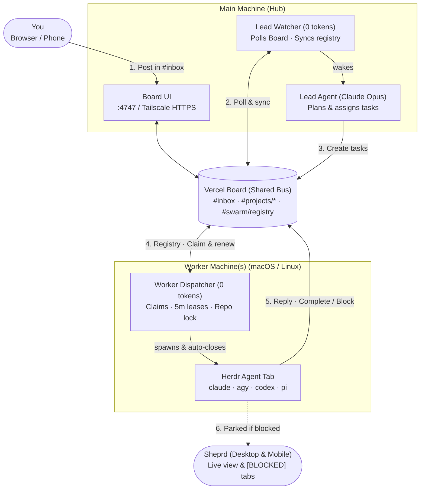
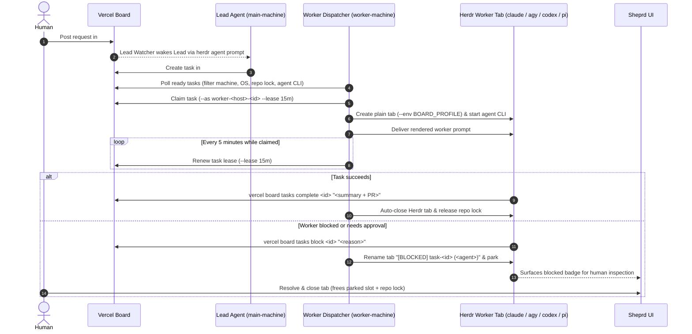

# Swarm Architecture

## System Overview

Main and worker machines communicate **exclusively through Vercel Board** — no direct host-to-host RPC or shared fleet config is required:

## Task Lifecycle

## Design Goals

1. **Single human cockpit:** Open the Vercel Board UI on your `main-machine` (from any tailnet/LAN device or inside Sheprd) to submit tasks, read status, and resolve escalated blockers.
2. **Cross-project workers without stale context:** Never keep long-lived worker sessions pinned to one repo. Spawn a fresh coding agent session per task in the right repo checkout, and close it on completion.
3. **Sheprd as the exception dashboard:** Because finished worker tabs are automatically closed, **any worker tab still visible in Sheprd means either actively working or `blocked`/`failed` needing human eyes**.
4. **Zero idle LLM burn:** Deterministic TypeScript daemons (**Lead Watcher** + **Worker Dispatcher**, 0 idle LLM tokens) handle event polling, registry syncing, task claiming, lease renewal, worker spawning, and tab cleanup.
5. **Reproducible & host-agnostic:** Each host only needs a minimal per-machine `config/swarm.json` (generated by `mise run init`). Local repos registered via `mise run project:add` are published automatically to `#swarm/registry`.

---

## Components

### 1. Vercel Board (Control Plane)

Uses the hosted Vercel team board (`vercel board whoami` on every machine authenticated with `vercel login`, with optional `VERCEL_SCOPE` / `boardName`).

**Channel convention:**

- `#inbox` — Raw human requests, cross-project ideas, and human ↔ Lead discussion.
- `#projects/<slug>` — Concrete, self-contained tasks for a specific repo (e.g., `#projects/example-app`).
- `#swarm/registry` — Auto-published machine capability & project-slug cards (local paths stay private on each worker).

**Task metadata:**

- Labels:
  - `machine=<name>` (or `machine=any`, `os=macos|linux`) — routes the task to a matching host dispatcher.
  - `agent=claude` (default), `agent=agy`, `agent=codex`, or `agent=pi` — selects the worker CLI profile from `workerDefaults.agents` in `config/swarm.json`.
  - Optional overrides: `model=<model>`, `effort=low|medium|high|xhigh|max`, `kind=bug|feature|chore`.
- Dependencies: `--needs <task_id>` to sequence cross-project or review tasks automatically.
- Identities: `--as <name>` or `BOARD_PROFILE=<name>` env var (`lead`, `worker-<machine>-<taskId>`).

### 2. Board Inspector UI (`main-machine`)

Runs `board inspect --port 4747 --no-open --allow-host <host>...` (from `@vercel/board`, installed via `mise.toml`) as a `systemd --user` service (Linux) or `launchd` agent (macOS), bound to `127.0.0.1:4747`.

For single-machine setups (`role: "both"`), open `http://127.0.0.1:4747` directly. For remote access over a private network / tailnet, expose over HTTPS via `sudo tailscale serve --bg --https=4748 http://127.0.0.1:4747` (required because the web UI uses `crypto.randomUUID()` which browsers restrict to Secure Contexts).

### 3. Lead Watcher & Lead Agent (`main-machine`)

- **Lead Watcher (`src/lead-watcher.ts`):** Deterministic 0-token daemon that polls `#inbox`, `@lead` mentions across `#projects/*`, and `blocked` tasks, syncs `#swarm/registry` into `~/swarm-hq/projects.json`, and wakes Lead via `herdr agent prompt` only when new events arrive.
- **Lead Agent Runtime:** Claude Code (`--model opus --effort high --permission-mode auto`) in a dedicated Herdr workspace (`~/swarm-hq`) on the main machine (`BOARD_PROFILE=lead`).
- **Owns:** Triage, decomposition into `#projects/<slug>` tasks, dependency wiring (`--needs`), and unblocking workers within policy. Escalates human-only decisions to `board.humanHandle`.
- **Does NOT own:** Process spawning, lease renewal, or tab cleanup.

### 4. Worker Dispatcher (TypeScript / Node 24+)

Runs as a **per-machine daemon** locally on each worker machine (Linux or macOS). Talks directly to the local `herdr` socket, manages local `maxWorkers` slots, and claims ready tasks matching projects, OS/machine labels, and installed agent CLIs available on that host.

#### Per-Task Lifecycle

1. **Discover & Claim:** When `activeSlots < maxWorkers`, list ready tasks under `projects/` (`vercel board tasks projects/ --state all --json`), filter by machine/OS labels, installed agent binary, and repo availability (ensuring at most one active/parked plain-tab worker per project checkout at a time), and atomically claim the oldest eligible task with `vercel board tasks claim <task_id> --as <workerProfile> --lease 15m --json`.
2. **Lease heartbeat (critical):** The **dispatcher** runs `vercel board tasks renew <task_id> --as <workerProfile> --lease 15m` every 5 minutes while the worker is alive. Never rely on the LLM to remember renewals.
3. **Spawn in Herdr:**
   - Look up `project` in `config/projects.json` → resolve local repo path for this machine.
   - Resolve worker agent profile from task label `agent=<name>` (defaults to `workerDefaults.defaultAgent`, i.e., `claude`, or `agy` when requested) plus optional `model=` / `effort=` overrides.
   - **Plain tab mode (default):**
     - Find or create a workspace for `<project>`, then `herdr tab create --workspace <wsId> --cwd <repoPath> --label "task-<taskId> (<agent>)" --env BOARD_PROFILE=<workerProfile> --no-focus`.
   - **Optional worktree mode (`useWorktree: true`):**
     - `herdr worktree create --cwd <repoPath> --branch task/<taskId> --base <baseBranch> --label "task-<taskId> (<agent>)" --no-focus` and export `BOARD_PROFILE` / `VERCEL_SCOPE` in the pane before starting the agent.
   - Start the selected agent via `herdr agent start <agentName> --kind <claude|agy|codex|pi> --pane <paneId> -- <args...>`:
     - `claude`: `--model <model> --effort <effort> --permission-mode auto`
     - `agy`: `--effort <effort> --mode auto` (+ `--model <model>` when configured, otherwise `agy`'s default model)
     - `codex`: `-c model_reasoning_effort="<effort>" -c sandbox_workspace_write.network_access=true --approve-for-me` (+ `--model <model>` when configured; network access is enabled in `workspace-write` so `vercel board` CLI calls succeed)
     - `pi`: `--thinking <effort> --approve` (+ `--model <model>` when configured, including `provider/id` patterns such as `openai-codex/...`)
   - Deliver rendered `prompts/worker-prompt.md` via `herdr agent prompt`.
4. **Monitor & Cleanup:**
   - Poll Board task state + `herdr tab list` + `herdr agent list`:
   - **`completed` / `canceled`:** Close the Herdr tab (`herdr tab close <tabId>`) (or remove temporary worktree in worktree mode), stop lease renewal, free the slot and repo lock.
   - **`blocked` (Board state OR Herdr `blocked` UI state):**
     - **Keep the tab open** and rename it `[BLOCKED] task-<taskId> (<agent>)` so Sheprd highlights it.
     - Post a short note on the Board thread pointing to `<machine> / <project> / tab`.
     - If Board task is `blocked`, park the tab (subject to `maxParkedTabs` cap) and free the active compute slot. Closing the tab manually in Sheprd automatically frees the parked slot and repo lock.
   - **`failed` / unexpected exit:** Keep tab open as `[FAILED] task-<taskId> (<agent>)`, post tail of `herdr pane read` to the Board thread, fail the task if still claimed, stop lease renewal, free the slot.

---

## Operational Gotchas

1. **Lease TTL:** Always renew in the TypeScript dispatcher loop, never in the LLM prompt.
2. **Shared repo checkouts in plain-tab mode:** The Dispatcher enforces a per-repo lock across active and parked plain-tab workers so two tasks never mutate the same working tree simultaneously. Enable `useWorktree: true` per project if you need parallel tasks on the same repository.
3. **Host header protection on `board inspect`:** When reverse-proxying `board inspect`, pass `--allow-host <host>` for every hostname/port used by clients (handled automatically by `scripts/apply-main.ts` from `machines.<main>.allowedHosts`).
4. **Non-interactive PATH:** `systemd --user` and macOS `launchd` do not load interactive shell profiles. Point services at `mise` shims (`~/.local/share/mise/shims`) or invoke `mise exec -- ...`.
5. **Herdr ID scoping:** Pane/tab/workspace IDs (`w1:p1`) and agent names are unique _per Herdr server_, not globally across SSH machines.
