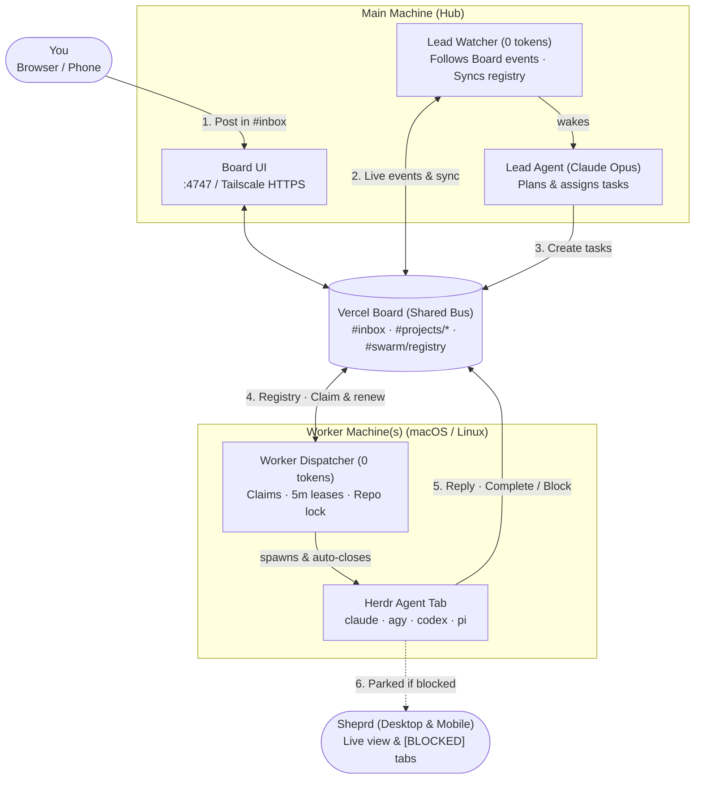
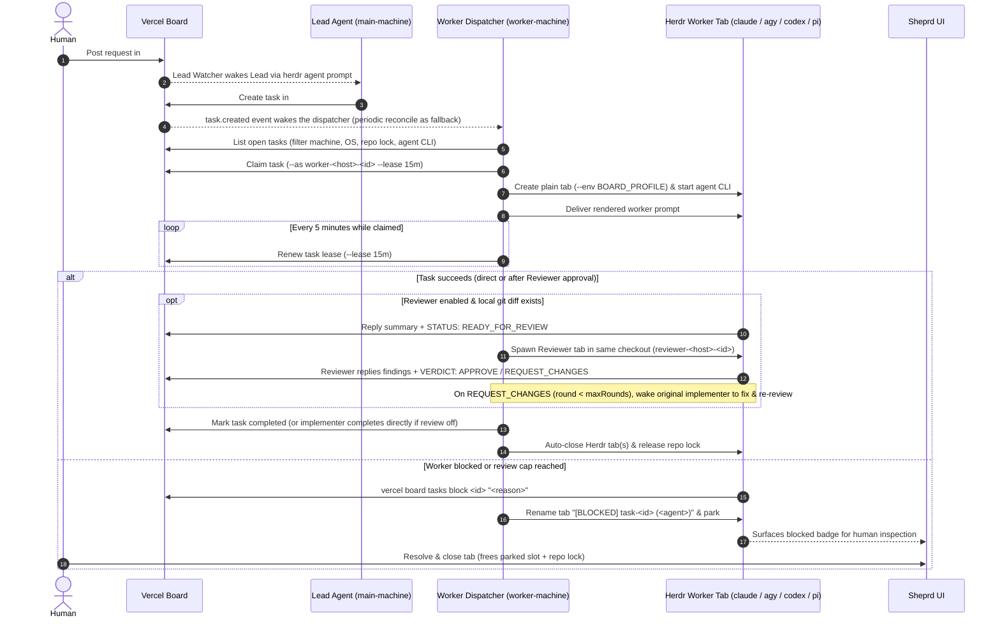
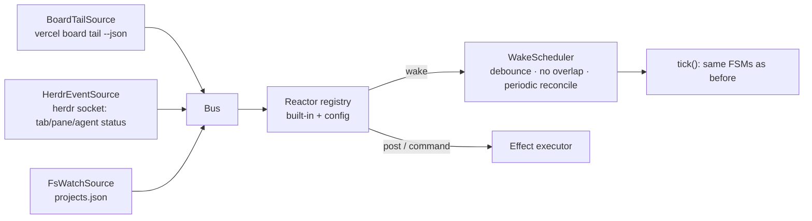

# Swarm Architecture

## System Overview

Main and worker machines communicate **exclusively through Vercel Board** — no direct host-to-host RPC or shared fleet config is required:

## Task Lifecycle

## Design Goals

1. **Single human cockpit:** Open the Vercel Board UI on your `main-machine` (from any tailnet/LAN device or inside Sheprd) to submit tasks, read status, and resolve escalated blockers.
2. **Cross-project workers without stale context:** Never keep long-lived worker sessions pinned to one repo. Spawn a fresh coding agent session per task in the right repo checkout, and close it on completion.
3. **Sheprd as the exception dashboard:** Because finished worker tabs are automatically closed, **any worker tab still visible in Sheprd means either actively working or `blocked`/`failed` needing human eyes**.
4. **Zero idle LLM burn:** Deterministic TypeScript daemons (**Lead Watcher** + **Worker Dispatcher**, 0 idle LLM tokens) follow live Board and Herdr events (with polling as the fallback) and handle registry syncing, task claiming, lease renewal, worker spawning, and tab cleanup.
5. **Reproducible & host-agnostic:** Each host only needs a minimal per-machine `config/swarm.json` (generated by `mise run init`). Local repos registered via `mise run project:add` are published automatically to `#swarm/registry`.

---

## Components

### 1. Vercel Board (Control Plane)

Uses the hosted Vercel team board (`vercel board whoami` on every machine authenticated with `vercel login`, with optional `VERCEL_SCOPE` / `boardName`).

**Channel convention:**

- `#inbox` — Raw human requests, cross-project ideas, and human ↔ Lead discussion.
- `#projects/<slug>` — Concrete, self-contained tasks for a specific repo (e.g., `#projects/example-app`).
- `#swarm/registry` — Auto-published machine capability & project-slug cards (local paths stay private on each worker).

**Task metadata:**

- Labels:
  - `machine=<name>` (or `machine=any`, `os=macos|linux`) — routes the task to a matching host dispatcher.
  - `agent=claude` (default), `agent=agy`, `agent=codex`, or `agent=pi` — selects the worker CLI profile from `workerDefaults.agents` in `config/swarm.json`.
  - Optional overrides: `model=<model>`, `effort=low|medium|high|xhigh|max`, `kind=bug|feature|chore`, and review controls (`review=skip|required`, `reviewer=<agent>`, `reviewer_model=<model>`, `reviewer_effort=<level>`).
- Dependencies: `--needs <task_id>` to sequence cross-project tasks automatically (downstream tasks only unblock after review passes).
- Identities: `--as <name>` or `BOARD_PROFILE=<name>` env var (`lead`, `worker-<machine>-<taskId>`, `reviewer-<machine>-<taskId>`).

### 2. Board Inspector UI (`main-machine`)

Runs `board inspect --port 4747 --no-open --allow-host <host>...` (from `@vercel/board`, installed via `mise.toml`) as a `systemd --user` service (Linux) or `launchd` agent (macOS), bound to `127.0.0.1:4747`.

For single-machine setups (`role: "both"`), open `http://127.0.0.1:4747` directly. For remote access over a private network / tailnet, expose over HTTPS via `sudo tailscale serve --bg --https=4748 http://127.0.0.1:4747` (required because the web UI uses `crypto.randomUUID()` which browsers restrict to Secure Contexts).

### 3. Lead Watcher & Ephemeral Lead Agent (`main-machine`)

- **Lead Watcher (`src/lead-watcher.ts`):** Deterministic 0-token daemon that follows the Board event stream for `#inbox` messages, `@lead` mentions across `#projects/*`, and newly `blocked` tasks (with a periodic full read of those channels as the catch-up path), syncs `#swarm/registry` into `~/swarm-hq/projects.json`, and persists queued events per thread in `~/.local/state/bordr-swarm/lead-watcher-state.json`.
- **Ephemeral Per-Thread Lead Sessions:** Rather than keeping one long-lived Claude session that accumulates cross-project context rot over days, Lead Watcher spawns a fresh Claude Code tab (`lead-<shortId>`, `--model opus --effort high --permission-mode auto`) in `~/swarm-hq` (`BOARD_PROFILE=lead`) scoped to a single `threadId` (`maxConcurrentSessions: 1` by default to prevent cross-thread races).
  - Lead reads the full thread verbatim via `vercel board read <id>` (and can inspect recent `#inbox` / `#projects/*` if another thread is referenced).
  - Rapid follow-up replies on the _same_ thread reuse the open tab before closing; once the session stays `idle` for `idleCloseSeconds` (default `15s`) with no queued events, Lead Watcher automatically closes the tab.
  - If a Lead session hits a startup/approval prompt in Sheprd, it is renamed `[BLOCKED] lead-<shortId>` and parked (capped by `lead.maxParkedTabs`) so other threads are not stalled, then automatically unparked and closed once resolved.
  - Every new Lead session automatically loads the latest `~/swarm-hq/CLAUDE.md` and `projects.json` with zero restarts needed.
- **Owns:** Triage, decomposition into `#projects/<slug>` tasks, dependency wiring (`--needs`), and unblocking workers within policy. Escalates human-only decisions to `board.humanHandle`.
- **Does NOT own:** Process spawning, lease renewal, or tab cleanup.

### 4. Worker Dispatcher (TypeScript / Node 24+)

Runs as a **per-machine daemon** locally on each worker machine (Linux or macOS). Talks directly to the local `herdr` socket, manages local `maxWorkers` slots, and claims ready tasks matching projects, OS/machine labels, and installed agent CLIs available on that host.

#### Per-Task Lifecycle

1. **Discover & Claim:** When `activeSlots < maxWorkers`, list open tasks under `projects/` (`vercel board tasks projects/ --state open --limit 100 --json`, following `--after <cursor>` until a page comes back short or empty), filter by machine/OS labels, installed agent binary, and repo availability (ensuring at most one active/parked plain-tab worker per project checkout at a time), and atomically claim the oldest eligible task with `vercel board tasks claim <task_id> --as <workerProfile> --lease 15m --json`.
2. **Lease heartbeat (critical):** The **dispatcher** runs `vercel board tasks renew <task_id> --as <workerProfile> --lease 15m` every 5 minutes while the worker is alive. Never rely on the LLM to remember renewals.
3. **Spawn in Herdr:**
   - Look up `project` in `config/projects.json` → resolve local repo path for this machine.
   - Resolve worker agent profile from task label `agent=<name>` (defaults to `workerDefaults.defaultAgent`, i.e., `claude`, or `agy` when requested) plus optional `model=` / `effort=` overrides.
   - **Plain tab mode (default):**
     - Find or create a workspace for `<project>`, then `herdr tab create --workspace <wsId> --cwd <repoPath> --label "task-<taskId> (<agent>)" --env BOARD_PROFILE=<workerProfile> --no-focus`.
   - **Optional worktree mode (`useWorktree: true`):**
     - `herdr worktree create --cwd <repoPath> --branch task/<taskId> --base <baseBranch> --label "task-<taskId> (<agent>)" --no-focus` and export `BOARD_PROFILE` / `VERCEL_SCOPE` in the pane before starting the agent.
   - Start the selected agent via `herdr agent start <agentName> --kind <claude|agy|codex|pi> --pane <paneId> -- <args...>`:
     - `claude`: `--model <model> --effort <effort> --permission-mode auto`
     - `agy`: `--effort <effort> --mode auto` (+ `--model <model>` when configured, otherwise `agy`'s default model)
     - `codex`: `-c model_reasoning_effort="<effort>" -c sandbox_workspace_write.network_access=true --approve-for-me` (+ `--model <model>` when configured; network access is enabled in `workspace-write` so `vercel board` CLI calls succeed)
     - `pi`: `--thinking <effort> --approve` (+ `--model <model>` when configured, including `provider/id` patterns such as `openai-codex/...`)
   - Deliver rendered `prompts/worker-prompt.md` via `herdr agent prompt`.
4. **Optional Code Review Gate (Board-native, zero GitHub/PR dependency):**
   - Configured globally per worker host in `config/swarm.json` (`workerDefaults.reviewer`, disabled by default until configured) and/or overridden per project in `config/projects.json` (`projects.<slug>.reviewer`, or via `mise run project:add -- <path> --reviewer <agent> --reviewer-model <model>`).
   - Resolution precedence: task labels (`review=skip|required`, `reviewer=`, `reviewer_model=`, `reviewer_effort=`) → project `reviewer` override → `workerDefaults.reviewer` → base agent profile in `workerDefaults.agents`.
   - Runs **inside the same task lease and worker slot** so `--needs` dependencies, plain-tab repo locks, and temporary worktrees stay intact end-to-end:
     1. Implementer commits on its task branch and posts a Board thread reply ending with `STATUS: READY_FOR_REVIEW` (all discussion stays in the Vercel Board task thread).
     2. If `skipIfNoDiff: true` (default) and no local Git changes exist (e.g. research/summary tasks), Dispatcher skips review and marks the task complete immediately.
     3. Otherwise, Dispatcher spawns a separate **Reviewer** agent (typically a different CLI/model) in a tab inside the same workspace/worktree with `BOARD_PROFILE=reviewer-<machine>-<shortId>` and `prompts/reviewer-prompt.md` (read-only instructions).
     4. Reviewer inspects the Board thread and `git diff <startHeadSha>..HEAD` and replies to the same Board thread ending with `VERDICT: APPROVE` or `VERDICT: REQUEST_CHANGES`.
     5. On **`APPROVE`**: Dispatcher closes both tabs (or removes the worktree) and marks the task `completed`.
     6. On **`REQUEST_CHANGES`**: Dispatcher closes the reviewer tab and wakes the **original implementer** in its warm tab with the review feedback for a fix commit and next review round. Once `maxRounds` (default `2`) is reached with blocking issues remaining, Dispatcher marks the task `blocked` (`awaiting_approval`), tags `@lead` + `humanHandle`, and parks `[BLOCKED]` in Sheprd.
5. **Monitor & Cleanup:**
   - Reconcile Board task state + `herdr tab list` + `herdr agent list` (on every relevant event, and periodically):
   - **`completed` / `canceled`:** Close the Herdr tab (`herdr tab close <tabId>`) (or remove temporary worktree in worktree mode), stop lease renewal, free the slot and repo lock.
   - **`blocked` (Board state OR Herdr `blocked` UI state):**
     - **Keep the tab open** and rename it `[BLOCKED] task-<taskId> (<agent>)` so Sheprd highlights it.
     - Post a short note on the Board thread pointing to `<machine> / <project> / tab`.
     - If Board task is `blocked`, park the tab (subject to `maxParkedTabs` cap) and free the active compute slot. If the task is later unblocked and resumed (`claimed`) in that tab, the dispatcher restores it to active tracking and removes the `[BLOCKED]` prefix; once it reaches `completed`/`canceled` (or is closed manually in Sheprd), the dispatcher auto-closes the tab and frees the parked slot and repo lock.
   - **`failed` / unexpected exit:** Keep tab open as `[FAILED] task-<taskId> (<agent>)`, post tail of `herdr pane read` to the Board thread, fail the task if still claimed, stop lease renewal, free the slot.

#### Live Events, Wake-ups, and Reactors

Both daemons run on a small event bus (`src/bus/`). Events are **hints**: they trigger an immediate, debounced (250 ms) reconcile of the same level-triggered FSMs, never a decision on their own. A missed event costs latency, not correctness.

- **Sources.** `BoardTailSource` supervises one `vercel board tail --json` child per daemon (the dispatcher tails `board.projectChannelPrefix`, Lead the whole board). It restarts it with capped backoff and resumes from the last cursor. It kills the whole process group on stop and runs a stall watchdog. `HerdrEventSource` subscribes on the local Herdr socket to `tab.closed`, `pane.exited`, `pane.closed`, and per tracked pane to `pane.agent_status_changed`. Herdr has no unsubscribe, so each pane gets its own connection. It is disabled for a non-local `herdrTarget`.
- **Health and intervals.** Each source reports `source.health`. With every enabled source healthy, the periodic full reconcile runs every `reconcileIntervalSeconds` (default 60). Otherwise it falls back to `pollIntervalSeconds`, the old polling behavior. While workers or Lead sessions are open, ticks keep the poll cadence, because idle reminders, idle-close, and startup grace are clock-driven.
- **Dispatcher wake-ups:** a claimable task event under the project prefix, any event on a tracked task, a reply in a tracked thread (review handoff and verdicts), Herdr events for tracked panes or tabs, and a `projects.json` change.
- **Lead Watcher:** Board events are queued and handled in order at the start of the next tick: 👀 on the message itself, wake events, and registry sync. They are de-duplicated against the periodic catch-up by message ID and by the per-thread seen markers. The tail cursor is persisted in the Lead state file and resumed with `--after`. If the cursor is rejected, Lead runs a full catch-up. The catch-up reads a project thread in full when its reply count jumped by more than one, so a mention followed quickly by another reply is not missed.
- **Reactors.** Every "when X, do Y" rule is a named reactor with a pure `matches(event)` / `react(event, ctx) → effects`. The built-ins are `dispatcher-wake`, `projects-reload`, `inbox-ack`, `lead-wake`, `registry-sync`, and `lead-session-wake`. User-defined reactors come from `swarm.json` `reactors[]` (a local command with the event on stdin, or a post). They run in Lead Watcher by default or, with `runOn: "dispatcher"`, on every worker, behind a per-reactor cooldown and a guard against reacting to their own posts. Each daemon logs its reactor list at startup.

#### Restart and Recovery

The dispatcher can be stopped, restarted, or killed at any point with tasks in any phase. Agents keep running in their Herdr tabs throughout.

- **State file:** the dispatcher keeps its tracked tasks (active and parked, with each one's phase, session handles, review round, and seen reply ids) in `~/.local/state/bordr-swarm/dispatcher-<machine>.json`. Set `DISPATCHER_STATE_PATH` to move it. The file is versioned and validated with Zod on boot. It is written atomically (temp file, then `rename`) at the end of any tick that changed something, and again on stop. A file that fails validation is renamed to `*.corrupt-<timestamp>`, and the dispatcher starts empty. A file written for a different machine is ignored. `--dry-run` never reads or writes it.
- **What survives a restart:** everything the dispatcher tracks. On boot it logs `Restored N active and M parked task(s)`. The next tick reconciles them as usual: it renews leases, delivers review verdicts, wakes implementers for fix rounds, keeps repo locks held by parked tabs, and closes tabs when tasks finish. A graceful stop (`SIGTERM`/`SIGINT`) persists state and exits after the current tick. It never closes tabs or releases tasks.
- **Finished while it was down:** the open-task list leaves out `completed`, `canceled`, and `failed` tasks. A tracked task missing from that list is looked up with `vercel board read <id> --json`, so its terminal state is still seen and its tab cleaned up.
- **Lease lapsed while it was down** (down longer than `board.leaseDuration`): the Board puts the task back to `ready`. If the task's agent is still alive, the dispatcher claims it again under the same worker profile and carries on. A plain `renew` would fail with `claim_lost`. If someone else got there first, it renames the tab `[ORPHANED] …`, posts one reply naming the new holder, and stops tracking the task. It leaves the task's state alone.
- **No usable state file** (first deploy, corrupt file, manual wipe): each tick, an orphan sweep looks for open tasks claimed by exactly `worker-<machine>-<shortId>` that nothing tracks.
  - Live `w-<shortId>` agent: the task is adopted as implementing. Its existing replies are marked seen, and its lease is renewed on the next tick.
  - Live reviewer `r<N>-<shortId>` as well: the dispatcher cannot tell which review round it is in. It blocks the task (`needs_input`) and parks the implementer tab `[BLOCKED]` for a human.
  - No live agent: it posts a reply and releases the task so it becomes `ready` again.
  - If Herdr cannot be reached, the sweep does nothing that tick.

---

## Operational Gotchas

1. **Lease TTL:** Always renew in the TypeScript dispatcher loop, never in the LLM prompt. After a lapse, `renew` fails with `claim_lost` and the same profile has to `claim` again. The dispatcher does this automatically (see Restart and Recovery).
2. **Shared repo checkouts in plain-tab mode:** The Dispatcher enforces a per-repo lock across active and parked plain-tab workers so two tasks never mutate the same working tree simultaneously. Enable `useWorktree: true` per project if you need parallel tasks on the same repository.
3. **Host header protection on `board inspect`:** When reverse-proxying `board inspect`, pass `--allow-host <host>` for every hostname/port used by clients (handled automatically by `scripts/apply-main.ts` from `machines.<main>.allowedHosts`).
4. **Non-interactive PATH:** `systemd --user` and macOS `launchd` do not load interactive shell profiles. Point services at `mise` shims (`~/.local/share/mise/shims`) or invoke `mise exec -- ...`.
5. **Herdr ID scoping:** Pane/tab/workspace IDs (`w1:p1`) and agent names are unique _per Herdr server_, not globally across SSH machines.
